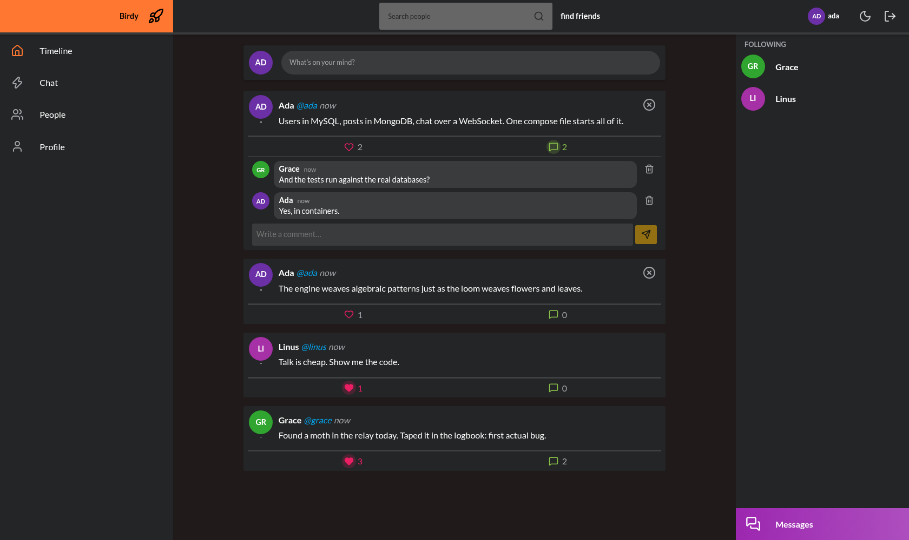
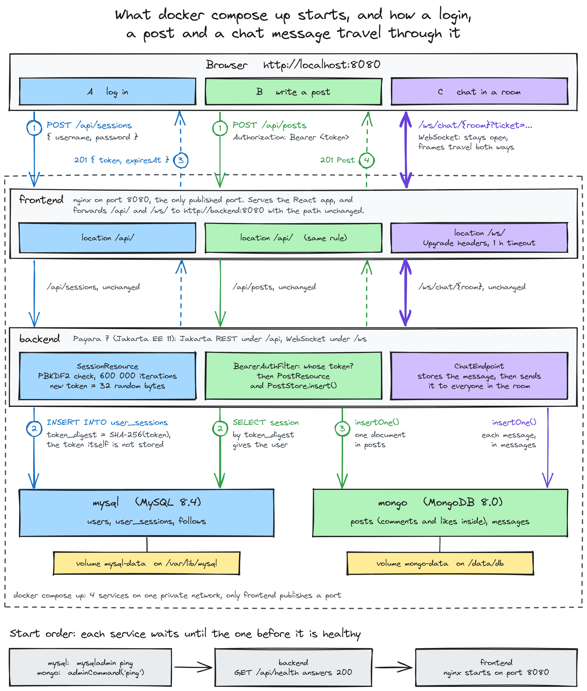
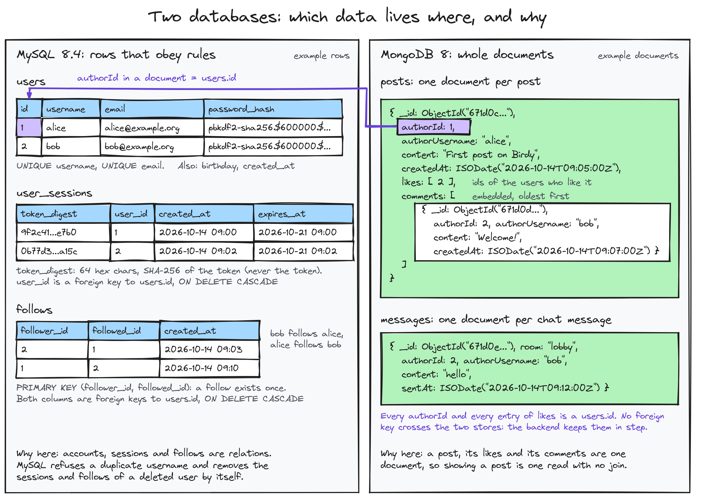
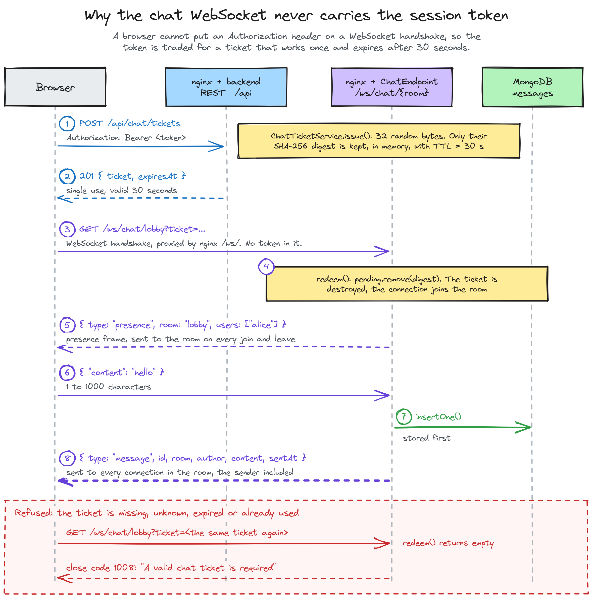
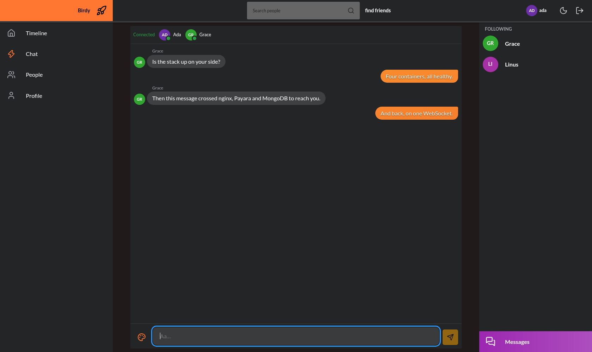
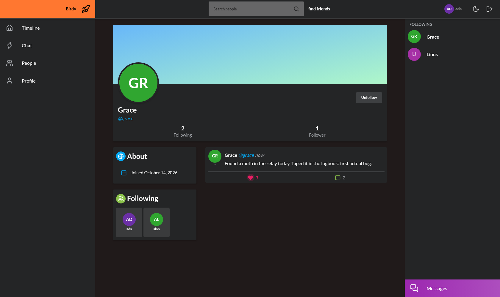
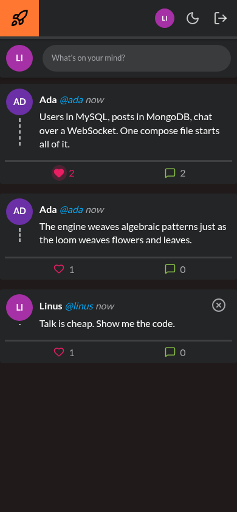

# Birdy

[](https://github.com/mbenimam/birdy/actions/workflows/ci.yml)


[](LICENSE)

A small social network, full stack, that starts with one command. You sign up, follow people, post, like, comment
and talk in a live chat room.

| | |
|---|---|
| **What it is** | A React single-page app, a Jakarta EE REST and WebSocket API, MySQL and MongoDB |
| **Who it is for** | Anyone who wants to read a complete web application small enough to hold in one head |
| **Stack** | React 19, TypeScript, Vite · Java 25, Jakarta EE 11 on Payara 7 · MySQL 8.4, MongoDB 8 · nginx · Docker Compose |
| **Proof** | 277 automated tests: 142 unit and 48 integration tests on the back end, 87 on the front end. The integration tests run against real MySQL, MongoDB and the real server image |



```bash
git clone https://github.com/mbenimam/birdy.git
cd birdy
cp .env.example .env        # then change the three passwords
docker compose up --build --wait
scripts/seed-demo.sh        # optional: four demo accounts with posts, likes and comments
```

Open <http://localhost:8080>. The seed script prints the demo password.

## Context

I wrote the first Birdy in 2020 with a teammate, as a university web project: hand-written Java EE servlets, a
React 16 app, and two databases hosted somewhere else. This repository is the same application rebuilt in 2026 the
way I would write it today, with both halves in one place.

The subject is the classic one. A **user** has an account. A user **follows** other users. A user writes **posts**;
the **home timeline** shows the posts of the people they follow, newest first. Posts collect **likes** and
**comments**. Everyone connected can talk in a **chat room** in real time.

The interesting part is that every layer of a web application is here, and each one is small:

- a browser app that keeps its screen in step with the server;
- an HTTP API with real status codes, validation and authentication;
- two kinds of storage, each used for what it is good at;
- a persistent two-way connection for the chat;
- the packaging that lets a stranger run all of it.

### Words used below

| Term | Meaning |
|---|---|
| Single-page app | A web page that loads once, then redraws itself and talks to the server in the background |
| REST API | A set of URLs the app calls with `GET`, `POST`, `PUT` and `DELETE`, exchanging JSON |
| Session token | A long random string the server gives you at login; sending it back proves who you are |
| Digest | The output of a one-way function (here SHA-256). Easy to compute, not reversible |
| Relational database | Tables with rows, columns and enforced links between them (MySQL) |
| Document database | Whole JSON-like objects stored and fetched in one piece (MongoDB) |
| WebSocket | A connection that stays open so both sides can send messages at any time |
| Reverse proxy | A server in front of the others that receives every request and passes it on (nginx) |
| Container | A packaged program with everything it needs, started the same way on any machine |

## How it fits together

`docker compose up` starts four containers. Only nginx is reachable from your machine; it serves the built React
app and forwards `/api/` and `/ws/` to the back end. The back end waits until both databases answer their health
checks, and nginx waits for the back end.



### Two databases, on purpose

Accounts, sessions and follow links are relations with rules: a username is unique, a follow link needs two
existing users, and deleting an account must remove its sessions. That is what a relational database enforces, so
they live in three MySQL tables.

A post is read far more often than it is written, and it is always shown with its comments and its like count. In
MongoDB a post is one document with the comments inside it, so the timeline needs one query per page instead of a
join per post. Chat messages are an append-only log and sit in a second collection.



The cost is that no single transaction covers both stores. Deleting an account removes the rows in MySQL, then the
user's posts, comments and likes in MongoDB, and an integration test checks that nothing is left behind.

### Logging in without storing anything worth stealing

A password is never stored. The server keeps a PBKDF2-HMAC-SHA256 hash with 600,000 iterations and a 16-byte
random salt, and the parameters are stored next to the hash so the cost can be raised later.

At login the server draws 32 random bytes, sends them to the browser as a 43-character token, and stores only the
SHA-256 digest of that token with an expiry date. A copy of the `user_sessions` table gives an attacker no usable
token. An unknown user and a wrong password get the same `401` and the same message.

### A chat that never puts the token in a URL

A browser cannot attach an `Authorization` header to a WebSocket handshake, and a token in the query string ends
up in proxy logs. So the app first asks the REST API for a **ticket**: a random value that works once and expires
after 30 seconds. The WebSocket opens with that ticket; the server redeems it, destroys it, and from then on knows
who is talking. A reused or expired ticket closes the connection with code `1008`.



Every message is stored first, then sent to every connection in the room, the sender included. The browser shows a
message only when it comes back, so what you see is what was saved.



## The API in one glance

Everything is under `/api` and returns JSON. Failures use the matching HTTP status and one error shape. The full
contract is in [docs/api.md](docs/api.md).

| Area | Routes |
|---|---|
| Accounts | `POST /users`, `GET /users/me`, `DELETE /users/me`, `GET /users?q=`, `GET /users/{username}` |
| Sessions | `POST /sessions`, `DELETE /sessions/current` |
| Following | `PUT` and `DELETE /users/me/following/{username}`, `GET /users/{username}/following`, `/followers` |
| Posts | `POST /posts`, `GET /posts?feed=home\|user`, `GET` and `DELETE /posts/{id}`, `PUT` and `DELETE /posts/{id}/like` |
| Comments | `GET` and `POST /posts/{id}/comments`, `DELETE /posts/{id}/comments/{commentId}` |
| Chat | `POST /chat/tickets`, `GET /chat/rooms/{room}/messages`, WebSocket `/ws/chat/{room}?ticket=` |
| Health | `GET /health` |

A real exchange, from the smoke test:

```text
GET /api/health              {"mongo":"UP","mysql":"UP","status":"UP"}
GET /api/posts (no token)    401
POST /api/sessions           token of 43 characters
POST /api/posts              6aceb05972c8401b3940ab21
GET /api/posts?feed=home     newest post is 6aceb05972c8401b3940ab21
DELETE /api/users/me         account removed, token now 401
```

## What each half is made of

**Back end** (`backend/`, 5,000 lines of Java). Jakarta REST resources instead of servlets, CDI for all wiring,
Bean Validation on request records, JSON-B, Jakarta Persistence for MySQL, the
official MongoDB driver for documents, and a Jakarta WebSocket endpoint for chat. The data source is declared in
code and reads its URL and credentials from environment variables. Packaged as a WAR on Payara Server 7 Web
Profile.

**Front end** (`frontend/`, 4,600 lines of TypeScript). Function components and hooks, React Router with a
protected layout, TanStack Query for everything that comes from the server, React 19 form actions for login and
signup, and a `useChat` hook that handles tickets, history, presence and reconnection with backoff. Likes and
follows update the screen at once and roll back if the server refuses. Sass for styles; the theme follows your system
setting and a toggle switches between dark and light.

| Profile | Phone |
|---|---|
|  |  |

## Checks

```bash
cd backend && ./mvnw verify     # 142 unit tests, then 48 integration tests in containers
cd frontend && npm ci && npm run lint && npm run typecheck && npm test && npm run build
scripts/smoke.sh                # against a running stack, through nginx
```

The integration tests build the server image from the Dockerfile, start it next to real MySQL and MongoDB
containers, and drive it over HTTP and WebSocket. They need Docker; nothing else has to be installed, the Maven
wrapper downloads Maven.

I checked that the tests can fail. I put 20 bugs back into the back end one at a time (no ownership check on
delete, expiry ignored, a ticket that works twice, a feed that leaks strangers' posts) and 63 into the front end.
All but one on each side broke a test straight away, and the two survivors now have a test of their own.

Three of the integration tests hammer the API from 10 to 16 threads at once, up to 40,000 requests in a run, and
require every answer to succeed and to belong to the right user. They exist because a load run once returned a
single 500 in 2,000 requests.

CI runs three jobs on every push: the back-end build, the front-end build, and the whole stack started with
Compose followed by the smoke test.

## Working on it

```bash
docker compose up -d --wait mysql mongo backend   # databases and API
cd frontend && npm run dev                        # Vite dev server with hot reload
```

The dev server proxies `/api` and `/ws` to `BIRDY_BACKEND_URL` (default `http://localhost:8081`), so publish the
back end on that port in a `compose.override.yaml` while you work on the interface.

| Variable (`.env`) | Meaning |
|---|---|
| `BIRDY_PORT` | Port published on your machine, default 8080 |
| `MYSQL_DATABASE`, `MYSQL_USER`, `MYSQL_PASSWORD`, `MYSQL_ROOT_PASSWORD` | MySQL database and accounts |
| `MONGO_DATABASE`, `MONGO_USER`, `MONGO_PASSWORD` | MongoDB database and account |
| `BIRDY_SESSION_TTL_HOURS` | How long a login lasts, default 168 |

## Layout

```text
compose.yaml        the four services
.env.example        the settings Compose reads
backend/            Jakarta EE 11 API: pom.xml, Maven wrapper, Dockerfile, db/schema.sql
frontend/           React 19 app: Vite, TypeScript, Dockerfile, nginx.conf
scripts/            smoke test and demo data
docs/               API contract, diagrams, screenshots
```

## Limits

- One back-end instance. Chat rooms and chat tickets live in memory, so a second instance would need a shared
  broker.
- No image upload: avatars are initials drawn from the username.
- The stack serves plain HTTP. Put it behind a TLS proxy before exposing it.
- No password reset and no email verification.

## License

[MIT](LICENSE)
